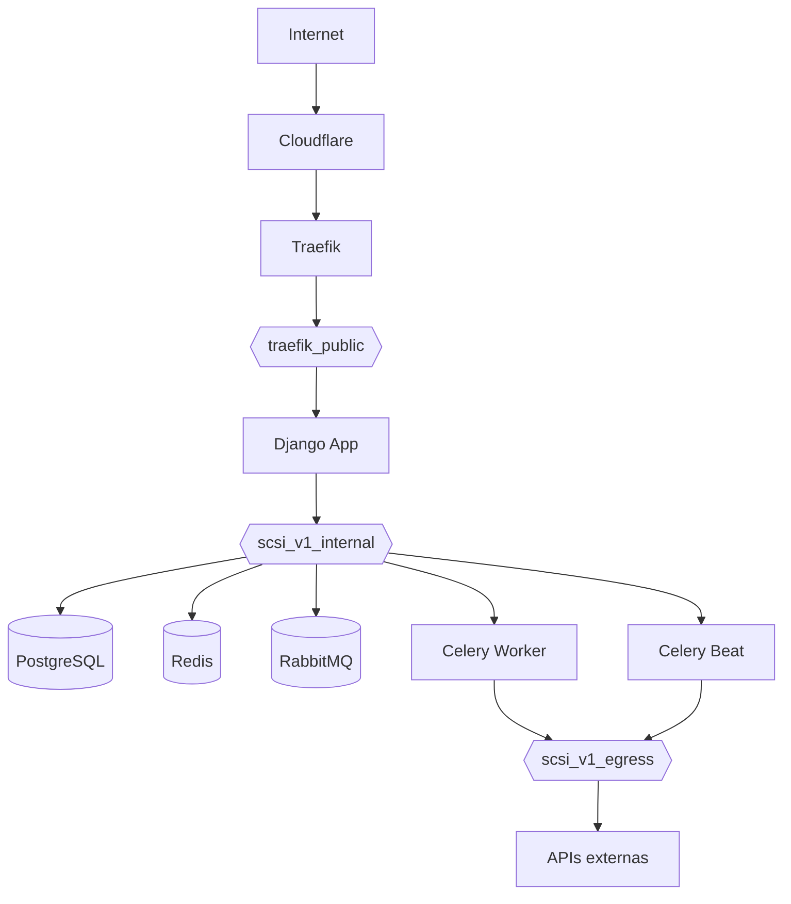

# Arquitetura

**Data:** 2026-10-20 (Sprint 0)
**Fonte:** [PRD](./PRD.md) seções 7 a 20.

## Stack

| Camada | Tecnologia |
|---|---|
| Linguagem | Python 3.14 (>3.13) |
| Framework | Django 6.1 (>6.0) |
| IA | LangChain >1.0 + LangGraph (OpenAI, GPT-5.5-mini) |
| Banco | PostgreSQL |
| Tasks | Celery (Worker + Beat) |
| Broker | RabbitMQ |
| Result backend / Cache | Redis |
| Web/Proxy | Traefik (TLS Let's Encrypt, DNS-01 Cloudflare) |
| Container | Docker (Compose local, Swarm em produção) |
| Registry | GHCR (`ghcr.io/pycodebr/scsi_v1`) |
| PDF | ReportLab + PyPDF |
| Documentação | MkDocs + Mermaid |

## Projeto Django

O projeto principal chama-se `core`. App base compartilhado: `base`. Domínios
são apps Django independentes, criados conforme a necessidade real de cada
sprint — não criar apps artificiais.

```text
sistema_dog_walker/
├── core/               # projeto Django (settings, urls, asgi, wsgi)
├── base/               # recursos compartilhados e fundamentais
├── clients/            # (Sprint 4)
├── dogs/               # (Sprint 5)
├── walks/              # (Sprint 7-8)
├── scheduling/         # (Sprint 6-7)
├── dashboard/          # (Sprint 10)
├── notifications/      # (Sprint 11)
├── ai/                 # (Sprint 12)
├── reports/            # (Sprint 13)
├── design_system/      # referência visual oficial
│   └── design-system.html
├── docs/               # documentação (MkDocs)
├── scripts/            # deploy.sh, backup.sh (Sprints 20-21)
├── manage.py
├── requirements.txt
├── .env.example
└── .gitignore
```

## Configuração

- Configuração por variáveis de ambiente (`python-decouple` + `dj-database-url`).
- `.env` local gitignored; `.env.example` versionado como documentação.
- `SECRET_KEY`, `DEBUG`, `ALLOWED_HOSTS`, `CSRF_TRUSTED_ORIGINS`,
  `TIME_ZONE`, `LANGUAGE_CODE`, `DATABASE_URL` e `OPENAI_API_KEY` lidos do
  ambiente.
- SQLite é o fallback local quando `DATABASE_URL` está vazio; PostgreSQL via
  `DATABASE_URL` (Sprint 1+).
- `USE_TZ = True`; timezone padrão `America/Sao_Paulo` (ver [ADR-0003](./adr/0003-timezone-e-idioma.md)).

## Infraestrutura de produção (Swarm)



Matriz de redes (PRD seção 41):

| Serviço | traefik_public | scsi_v1_internal | scsi_v1_egress |
|---|---:|---:|---:|
| Traefik | SIM | NÃO | NÃO |
| Django | SIM | SIM | NÃO |
| PostgreSQL | NÃO | SIM | NÃO |
| Redis | NÃO | SIM | NÃO |
| RabbitMQ | NÃO | SIM | NÃO |
| Celery Worker | NÃO | SIM | SIM |
| Celery Beat | NÃO | SIM | SIM |

Volumes nomeados: PostgreSQL, Redis, RabbitMQ, media, staticfiles, Let's Encrypt.

## Healthchecks

| Serviço | Verificação |
|---|---|
| Django | `GET /health/` — 200, sem autenticação, sem acesso ao banco |
| PostgreSQL | `pg_isready` |
| Redis | `redis-cli ping` |
| RabbitMQ | `rabbitmq-diagnostics check_port_connectivity` |

## Design system

Referência visual oficial: `design_system/design-system.html` (tema Duralux).
Nenhum estilo pode contradizer o design system (PRD seção 20).

- **Base:** Bootstrap 5 + camada do tema Duralux (classes prefixadas `nxl-`).
- **Tipografia:** Inter (corpo, sans-serif; alternativa Roboto Slab para
  títulos via customizador). Títulos `h1`–`h6` em `#283c50`, peso 700; corpo
  `#6b7885`, `0.84rem`, line-height 1.6. Escala tipográfica via utilitários
  `.fs-*` (ex.: `.fs-10`, `.fs-11`, `.fs-12`).
- **Cores semânticas:** primary `#3454d1`, success `#17c666`, danger `#ea4d4d`,
  warning `#ffa21d`, info `#3dc7be`, teal `#41b2c4`, indigo `#6610f2`,
  dark `#283c50`; fundo do app `#f3f4f6`; bordas `#e6e9ed`. Variantes soft
  (`.bg-soft-*`) para badges e avatares.
- **Shell da aplicação:** sidebar fixa `nav.nxl-navigation` com
  `.nxl-navbar`/`.nxl-link`/`.nxl-submenu`, header `.nxl-header`,
  `.page-header` (`.page-header-title` + breadcrumb + itens à direita:
  date-range picker e filtro), conteúdo em cards.
- **Componentes:** cards (`.card .stretch .stretch-full`, `.card-title`,
  `.card-header-action`), botões (`btn btn-primary/danger/success/warning/info`,
  outline, light-brand), formulários (`form-control`, `form-label`, `form-select`),
  tabelas (`table table-hover`, responsivas), badges, avatars
  (`.avatar-text`, `.avatar-image`, `avatar-xs`), breadcrumbs, paginação,
  tooltips.
- **Dados/métricas:** padrão de KPIs (footer stats), ApexCharts e Circle
  Progress para gráficos.
- **Ícones:** Feather Icons (`.feather-*`, principal) e Bootstrap Icons
  (`.bi .bi-*`, paginação).
- **Motion:** transições `all .3s ease`; sidebar com estados
  recolhido/expandido (`#menu-mini-button`/`#menu-expend-button`) e hamburger
  mobile (`.hamburger--arrowturn`).
- **Espaçamento/grid:** grid Bootstrap (`row`, `col-*`, `g-3`), utilitários
  `m-*`/`p-*`, `border-dashed`, `gap-*`.

## Segurança (produção)

- `DEBUG=False`; `ALLOWED_HOSTS` somente hostnames; `CSRF_TRUSTED_ORIGINS`
  com esquema.
- TLS termina no Traefik: `SECURE_PROXY_SSL_HEADER` (PRD seção 39).
- Secrets via Docker Secrets (`CLOUDFLARE_DNS_API_TOKEN` obrigatório).
- `.env` de produção fora do Git.
